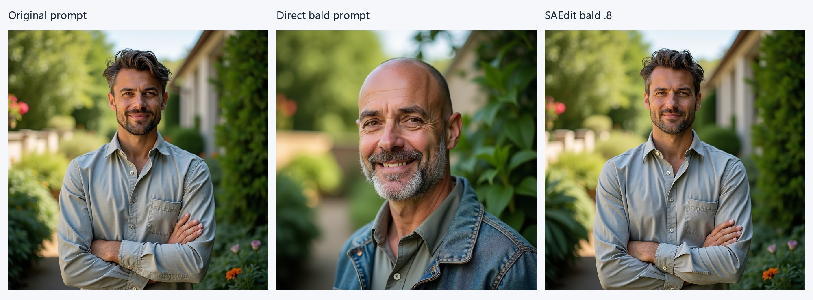

# SAEdit inference reproduction

SAEdit uses sparse autoencoders to steer text-token representations during image generation. This project reproduces selected FLUX.1-dev inference conditions and examines smiling, reconstruction effects and a baldness failure case. [Paper](https://arxiv.org/abs/2510.05081) · [Official implementation](https://github.com/ronen94/SAEdit)

## A. Smiling: exploratory strength control


Left to right: Baseline, Official 0, .2, .4, .8. LPIPS labels reference Official 0 and use full images. [Seed 42 controls](assets/smiling_seed42.jpg).

**Visual observation:** Seed 123 is consistent with stronger smiling at .4/.8; .2 is close to zero. Official 0 already changes a slight closed-mouth smile to a tooth-visible expression. Thus Baseline→edited changes cannot all be attributed to direction injection. Seed 42 already smiles strongly and provides weaker evidence of enhancement. This is not a quantified proof of monotonic or continuous semantic control.

| Seed 123 condition | LPIPS vs Baseline | LPIPS vs its own zero condition |
|---|---:|---:|
| Official 0 | 0.08928 | 0 |
| Official .2 | 0.09602 | 0.00782 |
| Official .4 | 0.11018 | 0.02748 |
| Official .8 | 0.11868 | 0.04329 |
| Target-only 0 | 0.04915 | 0 |
| Target-only .8 | 0.09409 | 0.11532 |

The repeated Official 0 is pixel-identical across the original and supplementary jobs; saved smiling directions also match. This supports reuse of the original .8 in this specific comparison, not universal determinism across software or hardware.

## B. SAE reconstruction diagnostics


Baseline → Official 0 isolates changes introduced by the full reconstruction path; Official 0 → Official .8 better isolates direction injection. Target-only 0 provides its own reconstruction control. These are controlled path comparisons, not proof that every image difference has a single cause.

| Directly computed pair | Seed 42 | Seed 123 |
|---|---:|---:|
| Baseline → Official 0 | 0.01357 | 0.08928 |
| Baseline → Official .8 | 0.02149 | 0.11868 |
| Baseline → Target-only .8 | 0.01667 | 0.09409 |
| Official 0 → Official .8 | 0.01531 | 0.04329 |

**Observation:** zero-strength SAE processing is not an identity operation. Overall subjects, clothing and garden layouts look similar in these examples, but identity and background preservation have not been quantitatively established. Lower Target-only distance to Baseline does not demonstrate superiority, especially without matched editing effectiveness.

## C. Baldness: failure and diagnosis




The direct prompt is `a portrait photo of a bald man in a garden`; all other generation settings remain fixed.

- **Visual finding:** Official .4/.8 retain dense hair; there is no clear progressive baldness. Expression changes occur instead. LPIPS vs Official 0 is **0.02274 / 0.05254**, which measures difference, not editing success.
- **Direct-prompt control:** unmodified FLUX produces a clearly bald person. Age appearance, identity cues, clothing and framing also change; this is not an identity-preserving edit.
- **Numerical checks:** bald direction shape `[65536]`, norm **0.999544**, **6826** strictly nonzero entries, no NaN/Inf; cosine with smiling direction **0.107890**. Nonzero counts include very small numerical values and are not counts of validated semantic features.
- **Intervention works numerically:** at saturated .4/.8, target SAE activation changes have norms **5.99314 / 11.98626**; decoded target-embedding differences from zero reconstruction are **6.95703 / 13.90733**. Token matching is correct. The latter numbers come from unchanged-callback representation replay, not a rerun of the old image denoising trajectories.
- **Interpretation:** no clear loading/token/no-op failure was identified. Direction specificity, transfer from pooled sentence features to `man`, and conditioning/timing effects remain hypotheses. Numerical injection success is not semantic editing success; one failure does not establish a general defect of SAEdit.

The complete callback replay is in the consolidated evidence file.

## Method and implementation boundary

SAEdit encodes T5 token embeddings with a sparse autoencoder, extracts an attribute direction from source/target Prompt Pairs, adds it to selected token activations during sampling, and decodes the result to condition FLUX. Sparse features offer a space for selective intervention; they do not guarantee that every extracted direction is semantically pure or effective.

We preserve upstream edit mathematics. The local CPU-offload adaptation only places decoded embeddings back on the original embedding device. **Target-only** is a separate local diagnostic: retain the decoded target token and restore original non-target embeddings. It still uses the SAE and is not a “No-SAE” ablation.

| Condition | Direction injection | Embeddings replaced |
|---|---|---|
| Baseline | None; no SAEdit callback | None |
| Official 0 | Zero | Entire sequence after SAE reconstruction |
| Official f | Direction added to `man` only | Entire sequence after SAE reconstruction |
| Target-only f | Same target-token direction | Target token only; non-target tokens restored |
| Direct bald prompt | None; no callback | Ordinary FLUX text encoding of the changed prompt |

For callback index `j=0…39`, the released implementation uses
`alpha(j,f) = min(exp(15*f*j/39)-1, 15*f)`.
Intervention is recomputed from cached original activations, not accumulated. A step-end callback affects the next denoising iteration; the final callback has no subsequent denoising step.

## Experiment data

[16 generation records](data/runs.json) map to 14 distinct original PNGs. [31 recorded LPIPS pairs](data/lpips.csv) retain the original values. [Evidence](data/evidence.json) contains original configuration snapshots, model verification, source hashes and callback replay. Evidence references are keys in that JSON. Pre-repair T5 outputs are excluded. LPIPS measures perceptual difference and does not establish semantic success or identity preservation.

## Environment and reproduction

- Upstream commit: `fc6e6704195375b06fb97cd7cc7389087cad19b9`
- FLUX revision: `3de623fc3c33e44ffbe2bad470d0f45bccf2eb21`
- SAE revision: `51c3ac09815815dbbcf7491148507a930e0d7944`

The [inference environment snapshot](requirements-inference.txt) records the actual Linux environment, including PyTorch 2.8.0, diffusers 0.35.1 and transformers 4.57.1. LPIPS was evaluated with separate dependencies in [requirements-evaluation.txt](requirements-evaluation.txt). It is an environment record, not a guarantee of cross-platform installation or bitwise reproducibility.

```bash
git clone https://github.com/ronen94/SAEdit.git /path/to/SAEdit
git -C /path/to/SAEdit checkout fc6e6704195375b06fb97cd7cc7389087cad19b9
python /path/to/this-reproduction/scripts/setup_upstream.py /path/to/SAEdit
```

Prepare a compatible environment and authorized local model copies separately. Follow the [reproduction guide](docs/reproduction.md) to verify manifests and create fresh integrity records. Do not reuse archived mtime checks on a different machine. No weights or credentials are provided.

Once setup and integrity verification are complete, from the upstream checkout:

```bash
PYTHONPATH=. HF_HUB_OFFLINE=1 python examples/run_case.py \
  --attribute smiling --mode official --factor 0.4 --seed 123 \
  --output experiments/my_smiling_123_04
```

Modes: `baseline`, `official`, `target_only`, `direct_prompt`; attributes: `smiling`, `baldness`. Existing output directories are refused. The portable runner is a packaging addition, syntax-checked only; archived results were produced by the [historical scripts](scripts/archive/), not by this new entry point. No new generation was performed during repository assembly.

## Limits and next questions

This stage covers two seeds for initial smiling controls and one seed for a strength scan and baldness. It does not reproduce all paper benchmarks, train a SAE, establish attribute generalization, prove strict identity preservation, or show Target-only superiority. Prompt Pair and injection-schedule ablations remain unperformed. Possible next work is a targeted study of bald-direction feature contributions and conditioning, followed by editing-effectiveness evaluation paired with preservation checks. These are research options, not experiments already executed.

See [attribution and licensing notes](NOTICE.md) and [citation](CITATION.bib).
